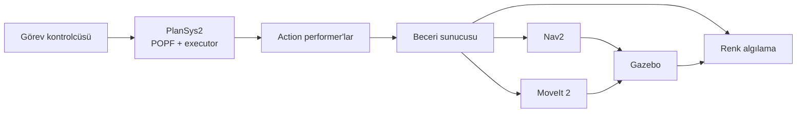

# Mobil Manipülatör ile Renk Ayıklama — Nav2 + MoveIt 2 + PlanSys2

ROS 2 Humble ve Gazebo Classic üzerinde çalışan otonom bir mobil manipülatör sistemi. Platform,
TurtleBot3 Waffle Pi tabanı ve OpenMANIPULATOR-X koldan oluşur. Robot dört odayı sırayla gezer ve her
odada aşağıdaki görevleri yürütür:

1. RGB-D kamera ile rastgele konumlandırılmış renkli küplerin tespiti,
2. her küpün kavranarak aynı renkteki kutuya yerleştirilmesi,
3. kapının yanındaki butona kol ile basılarak kapının açılması ve bir sonraki odaya geçilmesi.

Kutulara ve şarj istasyonuna yaklaşırken AprilTag işaretleri kullanılarak hassas hizalama yapılır.
Batarya seviyesi eşiğin altına düştüğünde görev planlayıcı yeniden plan üretir: robot mevcut işlemi
tamamlar, Oda 1'deki şarj istasyonuna döner, şarj olur ve görevine kaldığı yerden devam eder.

| Katman | Teknoloji |
|---|---|
| Görev planlama | PlanSys2 (POPF) |
| Navigasyon | Nav2 |
| Manipülasyon | MoveIt 2 |
| Algılama | OpenCV HSV segmentasyonu, derinlik görüntüsü, AprilTag |
| Simülasyon | Gazebo Classic |



## Gereksinimler

- Ubuntu 22.04
- ROS 2 Humble (desktop)
- Gazebo Classic 11
- colcon, rosdep

## Kurulum

Depoyu klonlayın:

```bash
git clone https://github.com/ogzhncyln/MobileRobotManipulator.git
cd MobileRobotManipulator/mrm_ws
```

ROS 2 Humble'ı [resmi talimatlara](https://docs.ros.org/en/humble/Installation/Ubuntu-Install-Debians.html)
göre kurun ve gerekli paketleri yükleyin:

```bash
sudo apt update
sudo apt install -y python3-colcon-common-extensions python3-rosdep \
    ros-humble-gazebo-ros-pkgs ros-humble-gazebo-ros2-control \
    ros-humble-navigation2 ros-humble-nav2-bringup \
    ros-humble-moveit ros-humble-apriltag-ros \
    ros-humble-plansys2-bringup ros-humble-plansys2-popf-plan-solver
```

TurtleBot3 Manipulation paketlerini (`turtlebot3_manipulation_description`, `_gazebo`,
`_moveit_config`) çalışma alanına ekleyin:

```bash
git clone -b humble https://github.com/ROBOTIS-GIT/turtlebot3_manipulation.git src/turtlebot3_manipulation
```

Kalan bağımlılıkları çözümleyip derleyin:

```bash
sudo rosdep init    # yalnızca ilk kurulumda
rosdep update
rosdep install --from-paths src --ignore-src -r -y

source /opt/ros/humble/setup.bash
colcon build --symlink-install
source install/setup.bash
export TURTLEBOT3_MODEL=waffle_pi
```

## Çalıştırma

Tam görev senaryosu:

```bash
ros2 launch mrm_bringup full_system.launch.py
```

Başlıca parametreler: `gui` (Gazebo arayüzü), `seed` (rastgele küp yerleşimi), `pieces_per_room`
(odadaki küp sayısı). Örnek: `gui:=false seed:=7 pieces_per_room:=3`.

Tam görev 30 dakikadan uzun sürer. Temel becerileri (yanaşma, kavrama, bırakma) yaklaşık 7 dakikada
doğrulayan alt simülasyonlar için:

```bash
ros2 launch mrm_bringup skill_test.launch.py scenarios:=pick_basic,pick_blind repeat:=3
```

## Paketler

| Paket | İçerik |
|---|---|
| `mrm_interfaces` | Mesaj, servis ve action tanımları |
| `mrm_gazebo_plugins` | `DoorButton` ve `LinkAttacher` Gazebo eklentileri (C++) |
| `mrm_description` | Robot modeli (xacro) ve ros2_control yapılandırması |
| `mrm_simulation` | Dünya üreteci, haritalar, küp üretici, batarya simülatörü |
| `mrm_perception` | Renkli küp algılayıcı |
| `mrm_skills` | Beceri sunucusu, hedef takipçisi, analitik IK, alt simülasyon testleri |
| `mrm_planning` | PDDL domain, PlanSys2 performer'ları, görev kontrolcüsü |
| `mrm_bringup` | Launch dosyaları, Nav2 / MoveIt / RViz yapılandırması |

## Lisans

Apache-2.0. ROBOTIS TurtleBot3 ve OpenMANIPULATOR-X modelleri ile yapılandırmaları kendi
lisansları (Apache-2.0) altında kullanılmıştır.
